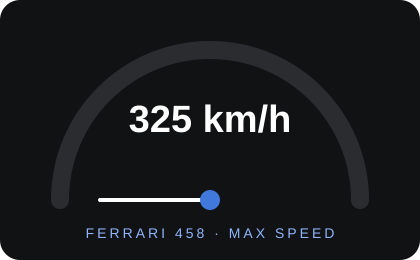
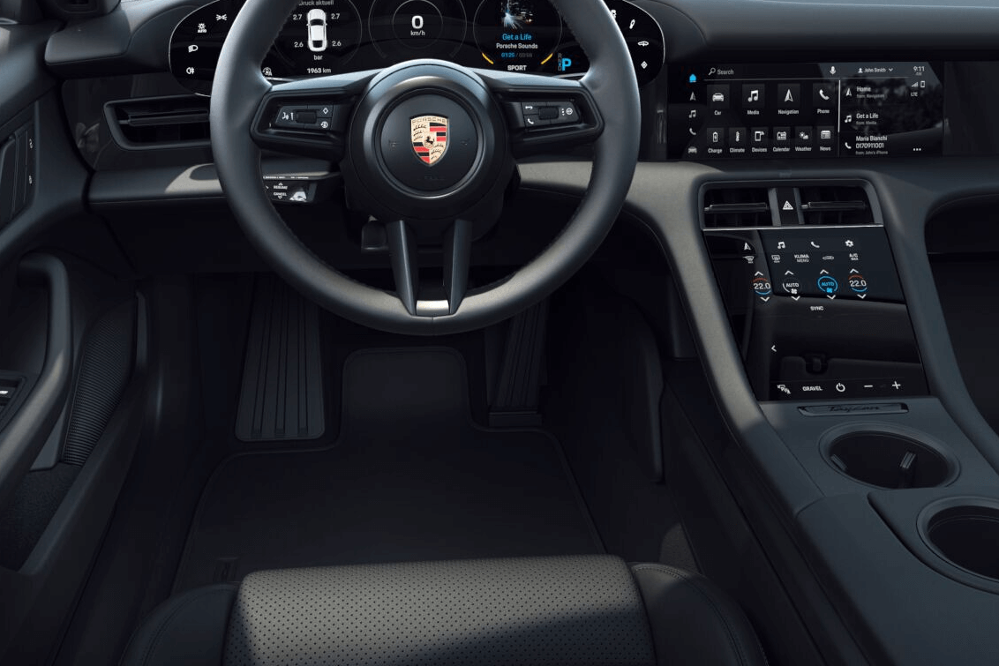
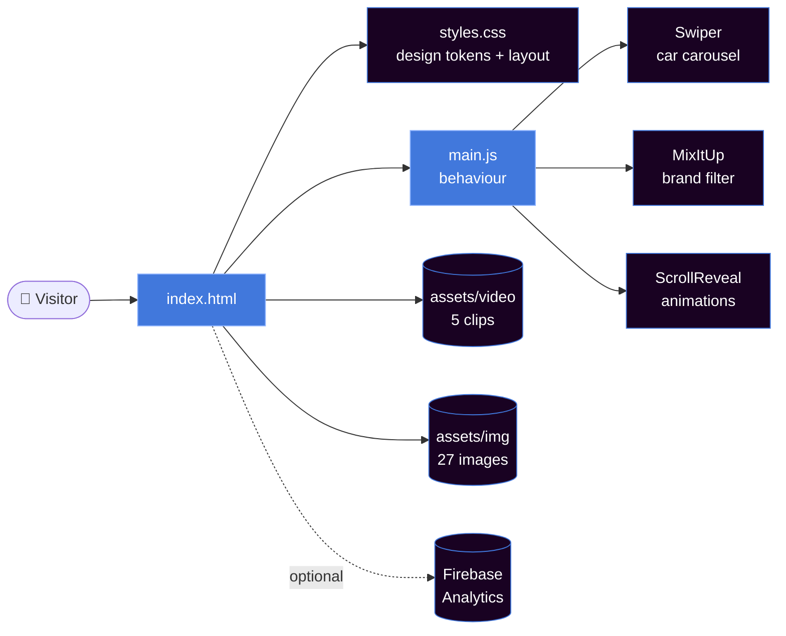
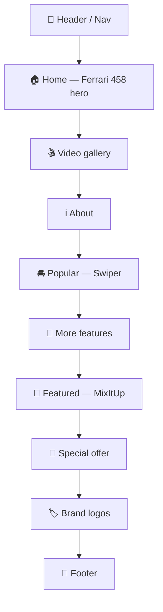
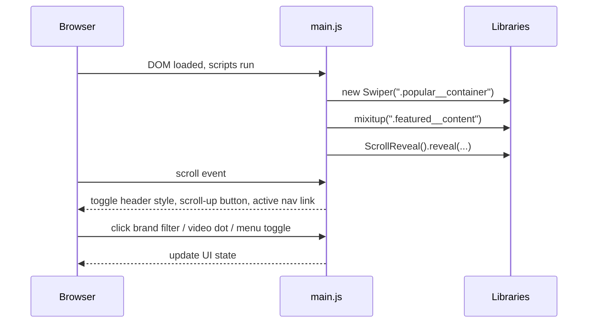

<div align="center">


<a href="https://github.com/Syed-Muhammad-Tayyab/SuperCarWebsite">
  
</a>

<br/>


[](https://github.com/Syed-Muhammad-Tayyab/SuperCarWebsite/stargazers)
[](https://github.com/Syed-Muhammad-Tayyab/SuperCarWebsite/network/members)
[](https://github.com/Syed-Muhammad-Tayyab/SuperCarWebsite/issues)
[](https://github.com/Syed-Muhammad-Tayyab/SuperCarWebsite/commits/main)


<br/>

**[✨ Features](#-features) · [🖼️ Gallery](#️-gallery) · [🧰 Tech Stack](#-tech-stack) · [🗺️ Architecture](#️-architecture) · [🚀 Getting Started](#-getting-started) · [☁️ Deployment](#️-deployment) · [🛣️ Roadmap](#️-roadmap) · [❓ FAQ](#-faq)**


</div>

<details>
<summary><b>📑 Table of Contents</b> (click to expand)</summary>

- [📖 About the Project](#-about-the-project)
- [✨ Features](#-features)
- [🖼️ Gallery](#️-gallery)
- [🧰 Tech Stack](#-tech-stack)
- [🗺️ Architecture](#️-architecture)
- [📁 Project Structure](#-project-structure)
- [🎨 Colour Palette & Typography](#-colour-palette--typography)
- [⚙️ How It Works](#️-how-it-works)
- [🚀 Getting Started](#-getting-started)
- [☁️ Deployment](#️-deployment)
- [🛣️ Roadmap](#️-roadmap)
- [❓ FAQ](#-faq)
- [🤝 Contributing](#-contributing)
- [📜 License & Notices](#-license--notices)
- [🙏 Credits](#-credits)
- [👨‍💻 Developer](#-developer)

</details>

---

## 📖 About the Project

**SuperCarWebsite** is a responsive, next-generation **car showcase website** with e-commerce-style product cards. It opens with a hero section for the **Ferrari 458**, a muted **background-video gallery** you can switch with dot buttons, a **Swiper** carousel of Porsche models, and a **MixItUp**-filtered grid of featured luxury cars (Tesla, Audi, Porsche). Sections fade and slide in with **ScrollReveal**, and the whole thing is written in plain HTML, CSS and JavaScript — no framework, no bundler, no install.

<div align="center">

| 📄 Pages | 🧩 Sections | 🚗 Car cards | 🖼️ Images | 🎞️ Videos | 🧮 Lines of code |
|:---:|:---:|:---:|:---:|:---:|:---:|
| 1 (single page) | 8 + footer | 10 (5 popular + 5 featured) | 27 | 5 | ~2,000 |



</div>

---

## ✨ Features

| | Feature | Details |
|:--:|---|---|
| 📱 | **Mobile-first & responsive** | Base styles target phones; media queries at 576 px, 767 px, 968 px and 1040 px scale up to desktop. |
| 🎬 | **Background video gallery** | Five autoplaying, muted, looping clips with a dot-navigation slider (`.slider__bg-navBtn`). |
| 🎠 | **Swiper car carousel** | Looping, grab-cursor slider with dynamic pagination bullets; 3 slides per view from 768 px. |
| 🔀 | **MixItUp brand filter** | Filter featured cars by **All / Tesla / Audi / Porsche** with a 300 ms animation. |
| 🌊 | **ScrollReveal animations** | Titles, cards, images and buttons reveal from top, left, right or bottom with staggered delays. |
| 🧭 | **Smart navigation** | Slide-in mobile menu, header that changes background after 50 px of scroll, and active-link highlighting while scrolling. |
| ⬆️ | **Scroll-up button** | Appears after 350 px of scrolling. |
| 🔥 | **Firebase ready** | `firebase.json` + `.firebaserc` included; Firebase Analytics snippet kept in `assets/js/firebase.js`. |
| 🎯 | **Smooth scrolling** | `scroll-behavior: smooth` for every in-page anchor. |
| 🧱 | **Zero build step** | Open `index.html` and it works. |

---

## 🖼️ Gallery

<div align="center">

### 🏁 Hero — Ferrari 458


### 🚘 Popular Porsche line-up (Swiper carousel)
<table>
  <tr>
    <td align="center"><br/><sub><b>Turbo S</b></sub></td>
    <td align="center"><br/><sub><b>Taycan</b></sub></td>
    <td align="center"><br/><sub><b>Turbo S Cross</b></sub></td>
  </tr>
  <tr>
    <td align="center"><br/><sub><b>Boxster 718</b></sub></td>
    <td align="center"><br/><sub><b>Cayman</b></sub></td>
    <td align="center"><br/><sub><b>About section</b></sub></td>
  </tr>
</table>

### 💎 Featured luxury cars (MixItUp filter)
<table>
  <tr>
    <td align="center"><br/><sub><b>Tesla Model X</b></sub></td>
    <td align="center"><br/><sub><b>Tesla Model 3</b></sub></td>
    <td align="center"><br/><sub><b>Audi E-tron</b></sub></td>
    <td align="center"><br/><sub><b>Boxster 987</b></sub></td>
    <td align="center"><br/><sub><b>Panamera</b></sub></td>
  </tr>
</table>

### 🔋 More features & special offer

&nbsp;&nbsp;


</div>

> 🎞️ The five background clips live in [`assets/video/`](assets/video) — run the site locally to see the video slider in action.

---

## 🧰 Tech Stack

| Layer | Technology | Version | Purpose |
|---|---|---|---|
| Markup | **HTML5** | — | Semantic single-page layout |
| Styling | **CSS3** (custom properties, grid, flexbox) | — | Design tokens, responsive layout |
| Logic | **Vanilla JavaScript** (ES6) | — | Menu, slider, scroll effects |
| Carousel | [Swiper](https://swiperjs.com/) | 8.0.7 | Popular cars slider |
| Filtering | [MixItUp](https://www.kunkalabs.com/) | 3.3.1 | Brand filter for featured cars |
| Animation | [ScrollReveal](https://scrollrevealjs.org/) | 4.0.9 | Reveal-on-scroll effects |
| Icons | [Remix Icon](https://remixicon.com/) | 2.5.0 (CDN) | UI and spec icons |
| Font | [Exo](https://fonts.google.com/specimen/Exo) | 400 / 500 / 600 | Typography |
| Hosting | [Firebase Hosting](https://firebase.google.com/docs/hosting) · GitHub Pages | — | Deployment |
| Analytics | Firebase JS SDK | 9.8.3 | Optional page analytics |

---

## 🗺️ Architecture



### Page flow



### Runtime sequence



---

## 📁 Project Structure

```text
📦 SuperCarWebsite
├── 📄 index.html                  # Main page (root copy — GitHub Pages / local use)
├── 📄 README.md                   # You are here
├── 📄 CONTRIBUTING.md
├── 📄 CODE_OF_CONDUCT.md
├── ⚙️ firebase.json               # Hosting config → serves /public, SPA rewrite to index.html
├── ⚙️ .firebaserc                 # Firebase project alias
├── ⚙️ .editorconfig
├── ⚙️ .gitignore
│
├── 🎨 assets/                     # Source assets (root copy)
│   ├── 🖼️ img/                    # 27 files — cars, logos, backgrounds, map.svg, favicons
│   ├── 🎞️ video/                  # vid_1.mp4 … vid_5.mp4
│   ├── 💅 css/
│   │   ├── styles.css             # Main stylesheet (~1,200 lines)
│   │   └── swiper-bundle.min.css
│   └── 🧠 js/
│       ├── main.js                # Menu, scroll effects, Swiper, MixItUp, ScrollReveal
│       ├── firebase.js            # Firebase Analytics init
│       ├── swiper-bundle.min.js
│       ├── mixitup.min.js
│       └── scrollrevealAnimation.min.js
│
├── 🌐 public/                     # Firebase Hosting root (mirror of index.html + assets/)
│   ├── index.html
│   └── assets/…
│
├── 📚 docs/
│   └── assets/                    # README artwork (animated SVGs)
│       ├── banner.svg
│       ├── footer.svg
│       ├── divider.svg
│       └── speedometer.svg
│
├── 🛠️ scripts/
│   ├── sync-public.sh             # Copy root site → public/
│   └── check-sync.sh              # Verify root and public/ match
│
└── 🐙 .github/
    ├── workflows/
    │   ├── pages.yml              # Deploy public/ to GitHub Pages
    │   └── sync-check.yml         # CI: root and public/ must match
    ├── ISSUE_TEMPLATE/
    │   ├── bug_report.md
    │   └── feature_request.md
    └── PULL_REQUEST_TEMPLATE.md
```

> 💡 **Why two copies?** Firebase serves `public/`, while the root copy lets you open the project directly. Edit the root files, then run `bash scripts/sync-public.sh`. The `sync-check` workflow flags any drift.

---

## 🎨 Colour Palette & Typography

Defined as CSS custom properties in `:root` of [`styles.css`](assets/css/styles.css).

| Token | Preview | HSL | Hex |
|---|:---:|---|---|
| `--first-color` |  | `hsl(219, 69%, 56%)` | `#4178DC` |
| `--first-color-alt` |  | `hsl(219, 69%, 52%)` | `#306BD9` |
| `--title-color` |  | `hsl(219, 8%, 95%)` | `#F1F2F3` |
| `--text-color` |  | `hsl(219, 8%, 75%)` | `#BABEC4` |
| `--text-color-light` |  | `hsl(219, 4%, 55%)` | `#888B91` |
| `--body-color` |  | `hsl(283, 89%, 7%)` | `#190222` |
| `--container-color` |  | `hsl(219, 4%, 7%)` | `#111213` |

**Typography:** [Exo](https://fonts.google.com/specimen/Exo) — weights 400 / 500 / 600. Headings scale from `1.5rem` (mobile) to `2.25rem` (≥ 968 px).

---

## ⚙️ How It Works

<details>
<summary><b>🎬 Video slider</b></summary>

Five `<video class="video__slide">` elements sit in the gallery section. The dots in `.slider__bg` map one-to-one to the videos; clicking a dot moves the `active` class to the matching button and video (`sliderNav(i)` in `main.js`).

</details>

<details>
<summary><b>🎠 Popular cars carousel (Swiper)</b></summary>

```js
new Swiper(".popular__container", {
  loop: true, spaceBetween: 24, slidesPerView: "auto", grabCursor: true,
  pagination: { el: ".swiper-pagination", dynamicBullets: true },
  breakpoints: { 768: { slidesPerView: 3 }, 1024: { spaceBetween: 48 } },
});
```

</details>

<details>
<summary><b>🔀 Featured filter (MixItUp)</b></summary>

Each `.featured__card` carries a brand class (`tesla`, `audi`, `porsche`). The filter buttons use `data-filter=".brand"` (or `all`), and MixItUp animates cards in and out over 300 ms. The active button gets `.active-featured`.

</details>

<details>
<summary><b>🧭 Scroll behaviour</b></summary>

| Scroll position | Effect |
|---|---|
| ≥ 50 px | Header gets `.scroll-header` background |
| ≥ 350 px | Scroll-up button gets `.show-scroll` |
| Inside a section | Matching nav link gets `.active-link` |

</details>

<details>
<summary><b>🌊 ScrollReveal</b></summary>

Global defaults: origin `top`, distance `60px`, duration `2500ms`, delay `400ms`. Individual groups override origin and delay, for example the hero button reveals from the bottom at `1000ms`, about-section content from left/right, and cards use `interval` for a staggered entrance.

</details>

---

## 🚀 Getting Started

### Prerequisites
A modern browser. Optionally Node.js or Python for a local server, and the Firebase CLI to deploy.

### 1️⃣ Clone

```bash
git clone https://github.com/Syed-Muhammad-Tayyab/SuperCarWebsite.git
cd SuperCarWebsite
```

### 2️⃣ Run locally

```bash
# Option A — just open it
open index.html            # macOS   |  start index.html (Windows)  |  xdg-open index.html (Linux)

# Option B — Python
python3 -m http.server 8080

# Option C — Node
npx serve .
```

Then visit **http://localhost:8080**.

### 3️⃣ Edit & sync

```bash
# edit index.html / assets/…, then mirror into public/
bash scripts/sync-public.sh
```

---

## ☁️ Deployment

<details>
<summary><b>🔥 Firebase Hosting</b></summary>

```bash
npm install -g firebase-tools
firebase login
firebase use --add          # choose your own Firebase project (replace the alias in .firebaserc)
bash scripts/sync-public.sh
firebase deploy --only hosting
```

`firebase.json` serves the `public/` folder and rewrites every route to `/index.html`.

</details>

<details>
<summary><b>🐙 GitHub Pages</b></summary>

1. Push the repo to GitHub.
2. Go to **Settings → Pages → Build and deployment → Source: GitHub Actions**.
3. Push to `main` — the [`pages.yml`](.github/workflows/pages.yml) workflow publishes the `public/` folder.

Your site will be at `https://syed-muhammad-tayyab.github.io/SuperCarWebsite/`.

</details>

---

## 🛣️ Roadmap

- [x] Responsive, mobile-first layout
- [x] Background video gallery with dot navigation
- [x] Swiper carousel + MixItUp brand filter
- [x] ScrollReveal entrance animations
- [x] Firebase Hosting config
- [x] GitHub Pages workflow + sync check
- [ ] Add the missing `assets/css/myCustom.css` (referenced in `index.html` but not in the repo) or remove the references
- [ ] Add meaningful `alt` text to all images (accessibility)
- [ ] Working newsletter form (the "Subscribe Now" button is a placeholder)
- [ ] Real social links in the hero and footer (currently empty)
- [ ] Cart / checkout flow for the e-commerce side
- [ ] Compress hero images and videos (≈ 23 MB of video today)
- [ ] Dark/light theme toggle
- [ ] Lighthouse score ≥ 90

---

## ❓ FAQ

<details>
<summary><b>Do I need to install anything?</b></summary>
No. It is plain HTML, CSS and JavaScript. Libraries are bundled in <code>assets/js</code>, except Remix Icon and Google Fonts which load from a CDN, so you need an internet connection for icons and fonts.
</details>

<details>
<summary><b>Why is there both a root copy and a <code>public/</code> folder?</b></summary>
Firebase Hosting serves <code>public/</code>. The root copy is the working copy. <code>scripts/sync-public.sh</code> keeps them identical.
</details>

<details>
<summary><b>The page looks unstyled in some places or the console shows a 404 for <code>myCustom.css</code>?</b></summary>
<code>index.html</code> and <code>styles.css</code> reference <code>assets/css/myCustom.css</code>, which is not part of the repository. The main styles live in <code>styles.css</code>, so the site still renders; add the file (or delete the references) to silence the error.
</details>

<details>
<summary><b>Can I change the colours?</b></summary>
Yes — edit the variables in <code>:root</code> at the top of <code>assets/css/styles.css</code>.
</details>

<details>
<summary><b>How do I add a new car card?</b></summary>
Duplicate an <code>&lt;article class="featured__card mix brand"&gt;</code> block in <code>index.html</code>, change the image, name, price and brand class, then run the sync script.
</details>

---

## 🤝 Contributing

Contributions, issues and feature requests are welcome! Read [CONTRIBUTING.md](CONTRIBUTING.md) and the [Code of Conduct](CODE_OF_CONDUCT.md), then:

1. 🍴 Fork the project
2. 🌿 Create a branch — `git checkout -b feat/amazing-feature`
3. 💾 Commit — `git commit -m "feat: add amazing feature"`
4. 📤 Push — `git push origin feat/amazing-feature`
5. 🔁 Open a Pull Request

---

## 📜 License & Notices

This repository currently ships **without a license file**, so by default all rights stay with the respective authors. If you plan to reuse or distribute it, add a license you are comfortable with and confirm it with the original author.

> ⚠️ **ScrollReveal** v4 is distributed under GPL-3.0 for compatible open-source and non-commercial use; a commercial license is required for commercial sites. Check [scrollrevealjs.org](https://scrollrevealjs.org/) before using this project commercially.

Car photos and brand logos belong to their respective owners and are shown here for demonstration purposes only.

---

## 🙏 Credits

- 🧑‍🎨 **Original project & design:** [Abdullah Moin](https://github.com/abdullahmoin) — original SuperCarWebsite (deployed at [mynext-car.web.app](https://mynext-car.web.app/)).
- 📚 Inspiration: [Bedimcode](https://github.com/bedimcode) front-end tutorials.
- 🧩 Libraries: [Remix Icon](https://remixicon.com/) · [Swiper](https://swiperjs.com/) · [MixItUp](https://www.kunkalabs.com/) · [ScrollReveal](https://scrollrevealjs.org/) · [Google Fonts](https://fonts.google.com/) · [Firebase](https://firebase.google.com/)
- 🎨 README tooling: [capsule-render](https://github.com/kyechan99/capsule-render) · [readme-typing-svg](https://github.com/DenverCoder1/readme-typing-svg) · [Shields.io](https://shields.io/) · [Mermaid](https://mermaid.js.org/)
- 🛠️ Repository design, documentation and tooling: **Syed Muhammad Tayyab**

---

## 👨‍💻 Developer

<div align="center">

### Developed by **Syed Muhammad Tayyab**

BSCS Student (Information Security) · Web & Full-Stack Developer · Cybersecurity Enthusiast

[](https://github.com/Syed-Muhammad-Tayyab)


⭐ **If you like this project, give it a star — it keeps the engine running!** ⭐


</div>
